```mermaid
gantt
    title Cold start to first token - 620 s measured
    dateFormat X
    axisFormat %M:%S
    section Cloud Run
    Schedule + image pull 70s     :done, sched, 0, 70s
    section Load
    Import + init 21s             :done, init, after sched, 21s
    Target weights from HF 406s   :crit, tw, after init, 406s
    Drafter weights 56s           :crit, dw, after tw, 56s
    section Allocate
    Mamba + KV pools 2s           :done, pools, after dw, 2s
    FlashInfer autotune 15s       :done, tune, after pools, 15s
    section Compile
    Prefill CUDA graph 33s        :active, g1, after tune, 33s
    Target verify graph 1s        :active, g2, after g1, 1s
    Draft verify graph 6s         :active, g3, after g2, 6s
    section Serve
    Warmup to first token 10s     :done, warm, after g3, 10s
```

# Qwen3.8-27B · NVFP4 · SGLang + DFlash 2 · ½ NVIDIA RTX PRO 6000

| | |
| --- | --- |
| Model | Qwen3.8-27B, [`RadixArk/Qwen3.8-27B-NVFP4-BF16-LMHead`](https://huggingface.co/RadixArk/Qwen3.8-27B-NVFP4-BF16-LMHead) |
| Weights | NVFP4 MLPs, FP8 attention and GDN projections, dense BF16 `lm_head`; **21.84 GiB resident** |
| KV cache | `fp8_e4m3`, a 180,573-token pool; **42 KiB/token** (32 target + 10 drafter) |
| Context | 262,144 native; **180,567 usable** per request (`max_req_input_len`) |
| Decode, seven workloads | **109.7 tok/s** streamed (prose 72.6, chat 78.0, translation 71.2, summary 87.7, code 152.9, math 144.4, JSON 161.2) |
| Decode, thinking on, sampled | prose 61.7, chat 68.6 tok/s |
| Prefill | 5,900 tok/s at 9k, 5,180 at 31k, 2,684 at 124k, all uncached |
| Mean accepted length | 3.5 of 8 over every decode batch of the full test (all workloads, thinking and sampling included) |
| Drafter | [DFlash 2](https://inco.ai/blog/dflash2/) [`z-lab/Qwen3.8-27B-DFlash2`](https://huggingface.co/z-lab/Qwen3.8-27B-DFlash2), BF16 3.72 GiB, block drafting at 8 |
| Engine | SGLang v0.5.20, the stock `lmsysorg/sglang:v0.5.20` image |
| Attention | FlashInfer for target and draft; FlashInfer GDN kernels for prefill |
| GPU | ½ NVIDIA RTX PRO 6000 Blackwell: 47.64 GiB of 96, SM120 |
| Batching | one slot, `--max-running-requests 1`, `--max-mamba-cache-size 5` |
| Quality | needle retrieval 5/5 at 30k and 120k, 12/12 multi-step math with thinking, 10/10 arithmetic |
| Vision | native, preprocessed on the GPU; input bounded to 1,024 image tokens |
| Cold start | ~10 min to first token; 0 s in practice, held warm by `minScale: '1'` |

Decode is `scripts/bench2.py`: each answer is streamed and timed from its first token to its last,
`(tokens - 1) / (t_last - t_first)`, two prompts per workload at up to 800 tokens, greedy with
thinking off unless stated. Prefill is time to first token over prompts of unique random words, so
the radix cache cannot serve them. Quality is `scripts/quality.py`.

The table above is the shipped configuration. The sections below give what fixes each value in
it.

```bash
bash docker/build.sh                 # mirror lmsysorg/sglang:v0.5.20 into Artifact Registry
gcloud alpha run services replace cloudrun/service.yaml
```

## Why this GPU is half a card

The fractional RTX PRO 6000 is a Cloud Run preview, and that is a different product from Compute
Engine's G4 machine types. The two carry separate quotas on separate services: `run.googleapis.com`
grants milliGPUs, where a half-GPU instance consumes 500, while `compute.googleapis.com` grants
`NVIDIA_RTX_PRO_6000` whole cards. A project can hold thousands of the former and none of the
latter, and G4 shapes were stocked out in every US zone while the Cloud Run grant was live and
idle.

Only 0.5 and 1 are accepted for `nvidia.com/gpu`; 0.25 is refused. The half card presents 47.64 GiB
and takes 10–16 vCPU with 40–64 GiB of system memory.

## The drafter is the configuration

Qwen3.8-27B ships an MTP head, and using it is the obvious choice. It is also the slower one. On
this card, raising MTP's draft depth buys accepted length and does not buy throughput:

| MTP draft tokens | Accepted length | Decode |
| --- | --- | --- |
| 2 | 2.58 | 61.2 tok/s |
| 3 | 3.22 | 66.1 |
| 5 | 3.78 | 68.0 |
| 7 | 4.07 | 67.5 |

Accepted length rises the whole way and decode stops at five. MTP drafts autoregressively, so a
depth of seven costs seven sequential passes of the draft head, and past five those passes cost
what the extra acceptance earns. The plateau is drafting time, not acceptance.

DFlash 2 removes exactly that cost. It is a block-diffusion drafter: it predicts a whole block of
eight tokens in one pass, keeps the top candidates at every position, and traces one path through
them with a lightweight selector. Two-tap dynamic convolutions in its backbone keep the draft from
decaying toward the end of the block. At 6.53 accepted tokens per target pass (a sustained decode
on the overlay image) it emits more than MTP does at any depth, and it pays one draft pass rather than eight.

Decoding is lossless. The target verifies every drafted token, so greedy output matches the
unspeculated model exactly and sampling preserves its distribution; the arithmetic set is 10/10
either way.

## The head must be dense

DFlash 2's selector runs a top-k over logits, which makes the precision of `lm_head` structural
rather than a rounding detail. The packed-FP4 checkpoint is 1.7 GB smaller and SGLang refuses it:

```
DFlash2 selector requires a dense FP16/BF16/FP32 target lm_head.
```

`RadixArk/Qwen3.8-27B-NVFP4-BF16-LMHead` is the same NVFP4 body with that head left dense, and it
is what the numbers above were measured on. Upstream carries a patch that runs a quantized head in
place through `lm_head.quant_method.apply`; it exists because the alternative - dequantizing once
into a dense copy - allocates several gigabytes during draft-graph capture.

## The image is stock, and the backport had a bug

DFlash 2 landed in SGLang on 2026-08-19 (PR #35371, PR #35496) and shipped in v0.5.19. Before that,
serving it meant overlaying eleven upstream modules onto `lmsysorg/sglang:qwen38-27b`, and the first
version of this deployment baked that overlay into its image. v0.5.20 needs none of it, and moving
to it on the same card and flags changed three things:

| | overlay image | v0.5.20 |
| --- | ---: | ---: |
| Usable context | 150,898 | **180,567** |
| Decode, prose / chat / code | 68.9 / 72.4 / 136.6 | **72.6 / 78.0 / 152.9** |
| Decode, mean of seven | 105.2 | **109.7** |
| Prefill at 9k / 31k / 124k | 4,911 / 4,809 / 2,592 | **5,900 / 5,180 / 2,684** |

The prefill column includes the GDN kernel below. The context comes from memory accounting, not
from a new flag: the overlay image allocated 8.27 GiB of KV for 150,904 tokens, about 55 KiB a
token, where the geometry needs 42; v0.5.20 allocates exactly 42, and loads the target in
21.84 GiB rather than 23.13.

The overlay also carried a correctness bug, sglang#37817. On a hybrid model the radix cache keeps
the GDN recurrent state at fixed checkpoints next to the attention KV. The overlay's DFlash worker
decided whether a verify step had crossed a checkpoint by comparing the sequence length before the
step with a length that had not yet been advanced, so it never saw a crossing, never saved the
state, and left cache entries whose attention KV and recurrent state described different
positions. A later request that reused such a prefix continued from the wrong state. The upstream
report measured 24 of 56 warm-cache next tokens wrong before the fix (#37818) and none of the stable
cases after it. Every multi-turn conversation reuses its prefix, so this was a production bug, not
a corner case. v0.5.20 carries the fix.

vLLM has had DFlash 2 since v0.28, but prefix-cache hits drop to zero with it (z-lab/dflash#165),
and nothing published shows it beating SGLang single-stream on SM120.

## Prefill runs on FlashInfer's GDN kernel

48 of the 64 layers are gated delta net layers, and SGLang only selects FlashInfer's GDN prefill
kernel by default on SM100; SM120 gets the Triton one. `--linear-attn-prefill-backend flashinfer`
picks it here, and it is most of the prefill gain above: at 9k and 31k, v0.5.20 alone gave 5,195
and 4,923 tok/s and the kernel took that to 5,900 and 5,180. It needs CUDA 13 and a prefill chunk
of at most 8,192.

It also made prefix caching consistent. With the Triton kernel, a follow-up turn served from the
radix cache and the same turn recomputed after `/flush_cache` gave different greedy text within
the first sentence, on both the overlay image and plain v0.5.20. With the FlashInfer kernel the two
are identical. The quality set is unchanged by it: 5/5 retrieval at 30k and 120k, 12/12 math.

## Flags that are not preferences

`--attention-backend flashinfer` is required on SM120; `trtllm_mha` is SM100-only. `--kv-cache-dtype
fp8_e4m3` is the best supported precision for this model, because SGLang's 4-bit KV paths are not
built for a hybrid-GDN architecture. `--tool-call-parser qwen3_coder` decodes the
`<tool_call><function=…>` payload this template emits; `hermes` parses none of it, and a model whose
tool calls are silently dropped answers nothing at all. `--speculative-draft-model-quantization
unquant` keeps the drafter in BF16 (see the withdrawn configuration below), and
`--speculative-draft-attention-backend flashinfer` gives the draft the same kernels as the target.

DFlash 2 is a pure-attention drafter of five sliding-window layers, so it needs no recurrent state
pool of its own. The `--mamba-*` flags and `--linear-attn-verify-backend` belong to the DSpark
recipe and are absent here; the target model keeps its own small state pool, sized by SGLang.

## Memory

Every step below is a logged number, not an estimate. The two Prometheus gauges are **target-only**
- `weight_memory_usage_gb` and `kv_cache_memory_usage_gb` exclude the drafter entirely and the
Mamba pool has no gauge at all - so metrics alone leave 11.9 GiB unaccounted. The startup log
closes it:

| Step | GiB | Avail after | Source |
| --- | ---: | ---: | --- |
| Card visible | 47.64 | | ½ of 96 |
| CUDA context + driver reserve | -2.40 | **45.24** | `Load weight begin. avail mem=45.24` |
| Weights, target | -21.84 | **23.40** | `Load weight end ... mem usage=21.84` |
| Weights, drafter | -3.72 | **19.65** | `type=DFlash2DraftModel, avail mem=19.65, mem usage=3.72` |
| Mamba/GDN state cache | -3.13 | 16.52 | `ssm 0.84 + intermediate_ssm 2.25 + conv 0.04` |
| KV pool, target (16 full layers) | -5.52 | **10.85** | `K size: 2.76 GB, V size: 2.76 GB` |
| KV pool, drafter (5 layers) | -1.72 | **9.11** | `K size: 0.86 GB, V size: 0.86 GB` |
| Autotune, prefill CUDA graph | -3.01 | 6.10 | `Capture target prefill CUDA graph end ... mem usage=2.29, avail mem=6.10` |
| Verify CUDA graphs | -0.03 | **6.07** | `available_gpu_mem=6.07` |

The line that matters for sizing context is the pair of KV pools. Geometry is `head_dim` **256**
with 4 KV heads, so one token of fp8 KV costs `2 × 4 × 256 = 2 KiB` per layer: **32 KiB** over the
target's 16 full-attention layers, plus **10 KiB** over the drafter's 5. A token therefore costs
**42 KiB**, and context on a speculative deployment is ~30% more expensive than on a plain one.
That is the price of speculation, and it is worth paying, but it should be paid knowingly. The
v0.5.20 pools match it exactly: 180,573 tokens at 32 KiB is 5.52 GiB, and at 10 KiB 1.72.

`--max-mamba-cache-size 5` is on the floor and deliberately so. The hybrid state cache is sized in
units of `mamba_ratio`, which is 5 here, so slots must be at least 5 per request; SGLang's
auto-sizing picks 8, and 4 fails at startup with `resulting max_num_reqs=0`. Both 5 and 8 admit
exactly one request - `floor(size/5)` - so the three extra slots buy no concurrency, only radix
buffer. Dropping them is worth **+10,738 tokens** and costs nothing measurable: prefix reuse stays
at 13,504 of 13,552 tokens (99.6%) and decode is 113.2 tok/s against 110.9 - both measured on
the overlay image with the two-call delta, so read them against each other rather than against
the table above. **Raising
`--max-running-requests` requires raising this in step**, or the server refuses to start.

The saving is smaller than the slot count suggests because only `ssm_state` scales with slots
(1.27 → 0.84 GiB). `intermediate_ssm_state_cache` is a fixed **2.25 GiB** - the largest single
piece of the Mamba pool and immovable. That is why 8 → 5 returns 0.43 GiB rather than 1.34.

At `--mem-fraction-static 0.80` the drafter's weights and KV are the difference between this and
an MTP deployment on the same card. The five points given up against 0.85 cost 45,824 tokens of
pool and no decode at all - 110.9 tok/s against 111.0, which is noise. Pool size and decode rate
are close to independent here, because one slot decoding one sequence touches a fixed working set
whatever the pool's ceiling is.

This model is a VLM, and vision cost GPU memory in a way the static budget does not see. The
"fast" Qwen2-VL image processor is the torchvision one: it allocates on the device, in the API
process, outside the engine's budget, and the allocation grows with the image. A 1024x1024 image
failed at `0.90` needing 352 MiB, and failed again at `0.85` needing 392 MiB with 154 MiB free.
Shrinking the fraction is the wrong instrument for this - the fraction is a constant and the
allocation is a function of the input, so it can always be outgrown.

Bounding the input fixes it at the source. Qwen2-VL's processor resizes rather than rejects:
aspect ratio is preserved and dimensions round to patch multiples, so a cap is a ceiling on cost
and not a rejection of large images. This checkpoint has patch_size 16 and merge_size 2, so a
token covers 32x32 = 1024 pixels and 1,048,576 pixels is exactly 1,024 image tokens. Preprocessing
then runs on the GPU, which is both what it is for and faster - a 3000x2000 image takes 0.52 s on
the device against 0.94 s on the CPU, because the resize happens where the pixels already are.

The kwarg is `size`, not `max_pixels`, and this is worth stating because the wrong one fails
silently. This processor's `preprocessor_config.json` carries `size: {longest_edge: 16777216,
shortest_edge: 65536}` and no `min_pixels`/`max_pixels` at all. `--mm-process-config
'{"image":{"max_pixels":1048576}}'` is accepted, echoed back by `/get_server_info` verbatim, and
ignored: a 3000x2000 image still produced 5,828 image tokens. `longest_edge` is an area in pixels
here rather than an edge length, which is why the untouched default is a 16,384-token ceiling.

| Image | Default | `size.longest_edge` 1048576 | Latency |
| --- | --- | --- | --- |
| 512x512 | 256 tok | 256 | 0.55 s |
| 1024x1024 | 1,024 | 1,024 | 0.65 s |
| 2048x2048 | 4,096 | **1,024** | 0.63 s |
| 3000x2000 | 5,828 | **1,014** | 0.52 s |

Below the cap nothing changes; above it, cost is flat. `0.80` is then headroom for a bounded
allocation rather than an attempt to outrun an unbounded one.

A 128x128 test image passes under every one of these configurations, which is how the first round
of vision testing missed all of it. Test at the size the clients actually send.

Two numbers describe the window and the smaller one binds: `context_length` is 262,144, but
`max_req_input_len` is what the pool will admit - **180,567** here. Size clients from the latter,
and re-read it after any change to `--mem-fraction-static`, `--max-mamba-cache-size`, the drafter
or the SGLang version, all of which move it. On the overlay image, where it read 150,898, it was
verified by bisection: 150,732 tokens was served and 151,388 refused with *exceeds the maximum
allowed length (150898 tokens)*.

## Quantizing the drafter buys context and speed, and is WITHDRAWN

**Do not use this configuration.** It is documented here because the measurements below are real
and the failure it caused is not visible in any of them.

In use, this drafter produced stretches of degenerate text - long runs of loosely associated words
with no syntax - most often inside thinking blocks. The deployment has been reverted to the BF16
drafter (`z-lab/Qwen3.8-27B-DFlash2`, `--speculative-draft-model-quantization unquant`). The
measurements in this section were taken on the overlay image with the two-call delta.

The cause is not established. What can be said is that the reasoning I used to rule the risk out
was wrong: I argued that the target verifies every drafted token, so a cheaper drafter could not
change what is emitted, only how fast it is proposed. That holds for speculative decoding with
rejection sampling. DFlash 2 drafts a whole block through its own `candidate_selector`, and if
that path accepts on a looser criterion, the drafter's distribution reaches the output - which
would show up first in the flattest distribution the model produces, which is exactly where it
did show up.

One number in the measurements now reads as a warning rather than a result: mean accepted length
came out at **4.19 of 8** here, against 3.60 reported by the checkpoint's author on their target
and 3.71 for the BF16 drafter. A quantized drafter whose blocks are accepted *more* often than
the unquantized one is not self-evidently a better drafter.

Nothing in the benchmark below would have caught this. Seven throughput workloads and a 10/10
arithmetic check all pass while prose comes apart, and `s/it` improves when long blocks of
nonsense are accepted. Judging a drafter needs generated text read as text.

## What the measurements were

The drafter was BF16 at 3.72 GiB resident. In NVFP4 it is **1.59 GiB**, and nearly all of the
2.13 GiB that frees turns into KV pool: at 42 KiB/token the window went **150,898 -> 206,492
usable, +36.8%** on the overlay image. That is the main result. A speculative deployment pays for its drafter twice -
once in weights, once in a second KV pool sized at the same token count - so shrinking the weights
compounds.

It is also faster, which was not obvious in advance. Quantizing a drafter risks the only thing a
drafter is for: if acceptance falls, the target verifies more rejected tokens and throughput drops.
The uncalibrated round-to-nearest version of this same checkpoint demonstrates exactly that on its
author's card - identical VRAM, 3.26 accepted of 8, and *slower* than BF16. The calibrated one
recovers it, and the recovery transfers to this target:

| workload | BF16 drafter | NVFP4 calibrated | |
| --- | ---: | ---: | ---: |
| prose | 76.2 | **84.5** | +10.9% |
| chat | 76.2 | **80.0** | +5.0% |
| translation | 76.2 | **77.8** | +2.1% |
| summary | 98.8 | **102.5** | +3.7% |
| code | 135.7 | **151.6** | +11.7% |
| math | 148.8 | **160.6** | +7.9% |
| JSON | 164.3 | **168.0** | +2.3% |
| **mean** | **110.9** | **117.9** | **+6.3%** |

Both columns are `scripts/bench.py` against this deployment, two runs each, spread under 0.5%.
Arithmetic stays 10/10: the target verifies every drafted token, so a cheaper drafter cannot change
what is emitted, only how fast it is proposed. Mean accepted length measured 4.19 of 8 across these
workloads.

The two flags are the whole change - `--speculative-draft-model-path` and
`--speculative-draft-model-quantization modelopt_fp4`. The base weights are byte-identical to
`z-lab/Qwen3.8-27B-DFlash2` (same 3,848,817,896 bytes, same LFS sha256), so this is a requantization
of the drafter already in use rather than a different model.

## Measured and dropped

Each of these was deployed as its own service on the same half card and measured against the
shipped configuration.

| Change | Result |
| --- | --- |
| `--enable-torch-compile` | Decode CUDA graph capture fails at startup, `bmm_fp8_run_with_algo failed`, on both boots tried. Reported elsewhere as +12% median on a full card. |
| FlashInfer b12x NVFP4 GEMM (sglang#38170, open, patched in) | Active and autotuned, and decode unchanged: prose 71.3 against 71.3, chat 75.6 against 75.8. Only the MLPs are NVFP4 in this checkpoint. |
| `--chunked-prefill-size 8192` | Prefill -1% to +3% against 4096, and more activation memory. |
| `--speculative-draft-window-size 2048` | The drafter attends to 2,048 tokens anyway, and its KV pool stays sized to the full context, so nothing is freed. |
| Draft block 12 or 16 with the block-8 drafter | Best case up, median flat, prose slower (helix.ml's measurement on the same model). |

## Serving

`cloudrun/service.yaml` is the deployed configuration. Three things about it are Cloud Run's rather
than SGLang's: the container must listen on 8080, `gpu-zonal-redundancy-disabled` must be `'true'`
or the deploy hangs, and `minScale: '1'` is load-bearing for the reason the next section measures.

`--max-model-len` has no counterpart here, but the equivalent trap does: SGLang validates
`input + completion ≤ context` and returns 400, where llama.cpp clamps. A client that asks for the
whole 262,144-token window beside a 53-token prompt is refused, and a harness that reads that 400
as context overflow will compact, retry and fail. Cap the completion.

## Cold start

A cold start is 620 s wall clock on the overlay image - 10m18s from `services replace` to serving.
Phase boundaries are read off the startup log's own timestamps, `22:52:11` to `23:01:21`. On
v0.5.20 the phases are the same size: target weights 409 s, drafter 57 s, prefill graph 27 s.



**462 s of the 620 - three quarters - is pulling weights over the network**, 23 GB at 57 MB/s from
HuggingFace plus the drafter's 3.7 GB. Nothing else is close: graph capture is 40 s and every
allocation together is 17 s.

Two levers, and only one of them is shipped:

| Lever | Effect | Status |
| --- | --- | --- |
| `minScale: '1'` | Users pay **0 s**. The instance is never reaped, so no request ever meets a cold start. | **Shipped**, load-bearing |
| Bake weights into the image | Replaces a 57 MB/s HuggingFace pull with an in-region Artifact Registry layer pull. The 70 s already spent pulling this image is the evidence it is the faster path. | Not built - **saving unmeasured** |

`minScale: '1'` turns cold start from a user-facing cost into a deploy-time one: the 620 s is only
ever paid when a revision is replaced. It is not a tuning preference - with `maxScale: '1'` and no
warm instance, every request during those ten minutes is answered with *no available instance*.

Baking is the obvious remaining win, and the honest position is that its size is not yet known:
building a ~25 GB image and timing it is the only way to find out, and this repo has not done it.
`docker/build.sh` is where it would go.

## Reproducing

```bash
export SGLANG_API_KEY=...
python3 scripts/bench2.py  https://YOUR-SERVICE.run.app     # seven workloads, streamed decode
python3 scripts/quality.py https://YOUR-SERVICE.run.app     # needle at 30k/120k, 12 math problems
python3 scripts/bench.py   https://YOUR-SERVICE.run.app     # two-call delta + arithmetic
```

`bench.py` is the two-call delta: the same prompt at 60 and 600 tokens, `(c2-c1)/(d2-d1)`. It
cancels prefill and network, but it assumes both builds write 600 tokens. Across SGLang versions
the greedy text differs, and when one build answers in 106 tokens the delta covers 46 of them and
reads a translation workload as 37% slower than it is; a single request arriving mid-run gave a
negative rate. `bench2.py` times each streamed answer from its first token to its last, which
holds for any answer length.

## Credit

The serving recipe follows [`MiaAI-Lab/Qwen3.8-27B-RTX-6000-PRO-SGLang-DSpark`](https://github.com/MiaAI-Lab/Qwen3.8-27B-RTX-6000-PRO-SGLang-DSpark),
which worked out the flags and the memory budget for the full card and carried the DFlash 2
backport overlay the first version of this build used. The two-call delta measurement is its `bench/ndec.py`. DFlash 2
is [z-lab/dflash](https://github.com/z-lab/dflash); the drafter card is
[`z-lab/Qwen3.8-27B-DFlash2`](https://huggingface.co/z-lab/Qwen3.8-27B-DFlash2). The NVFP4
quantization of that drafter, and the activation calibration that makes it worth using, are
[`maurienne-ai/Qwen3.8-27B-DFlash2-NVFP4-RTNcal`](https://huggingface.co/maurienne-ai/Qwen3.8-27B-DFlash2-NVFP4-RTNcal). The L4 companion to
this deployment is [`Qwen3.8-27B-UD-Q4_K_XL-L4`](https://github.com/hanxiao/Qwen3.8-27B-UD-Q4_K_XL-L4).
